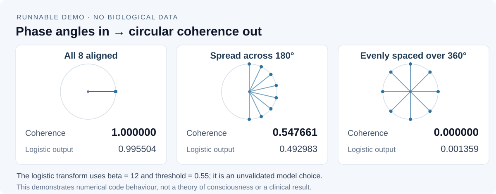

# RIF: Resonant Inference Field

**A public research reference implementation for testing the Resonant Inference Field hypothesis.**

[Albert Tan Sin Hon](https://www.alberttansinhon.com/) and contributors are developing a falsifiable computational framework for examining whether nested visceral rhythms and cortical connectome modes exhibit measurable phase relationships associated with conscious access.

**Status:** early research prototype. The repository contains toy simulations, mathematical utilities and research-governance templates. It does not establish the hypothesis, provide a clinical conclusion or constitute a medical device.

## See it in action

Give the current API eight **synthetic phase angles** and it computes their
circular coherence. Three controlled arrangements produce the observed outputs
below; the second number is the code's unvalidated logistic transform.



After installing the package with the [quickstart](#quickstart), run from the
repository root:

```bash
python scripts/readme_demo.py
```

The command prints the actual [JSON output](docs/demo/output.json). Read the
[input formulas and reproduction notes](docs/demo/README.md) to inspect the
calculation. The example uses no biological data and supplies no evidence that
the logistic output is a calibrated probability of conscious access.

## Public research layer

The public repository is intended to support scrutiny, replication and constructive criticism. It may contain:

- source code for RIF-coherence and connectome-harmonic calculations;
- synthetic or openly licensed examples;
- reproducible tests, methods and research documentation;
- ethics and data-governance templates that contain no participant information.

Human-subject data, protected health information, consent records, participant identifiers, private ethics correspondence, credentials and unpublished partner data must remain outside this repository. See [PUBLIC_PRIVATE_BOUNDARY.md](PUBLIC_PRIVATE_BOUNDARY.md).

## Quickstart

Python 3.10 or later is required. The installable project is in `rif-project/`.

```bash
git clone https://github.com/Albertito-AI/AlberTito-MasterMind.git
cd AlberTito-MasterMind/rif-project
python -m venv .venv
# macOS / Linux
. .venv/bin/activate
# Windows PowerShell: .venv\Scripts\Activate.ps1
python -m pip install -U pip
python -m pip install -e '.[dev,analysis]'
pytest -q
python examples/01_simulate_and_compute_rif.py
```

## Minimal API

```python
from rif.rif import rif_coherence, ignition_probability
from rif.signal import bandpass_phase
from rif.harmonics import connectome_harmonics

coherence = rif_coherence(phases)
probability = ignition_probability(coherence, beta=12.0, threshold=0.55)
eigenvalues, eigenvectors = connectome_harmonics(adjacency_matrix, k=32)
```

## Repository structure

```text
rif-project/
  src/rif/               core library
  tests/                 unit tests
  examples/              synthetic demonstrations
  docs/                  research documentation
  ethics/                governance and IRB templates
  data/                  placeholder only; no participant data
  notebooks/             analysis workspace guidance
```

## Research boundary

The current implementation computes quantities from supplied inputs. It does not authenticate data provenance, establish causal relationships, diagnose a person, or validate a theory of consciousness. Any human study requires appropriate ethics approval, lawful data governance and an independently reviewed protocol.

## Licence and citation

Original project code is licensed under the [Apache License 2.0](LICENSE), including its express patent licence. Third-party dependencies and datasets remain subject to their own terms.

Citation metadata is provided in [CITATION.cff](CITATION.cff). The current concept citation is:

> Tan, A. and Contributors. *RIF: Resonant Inference Field (Bentov-2.0)*, version 0.1.0, 2025.
